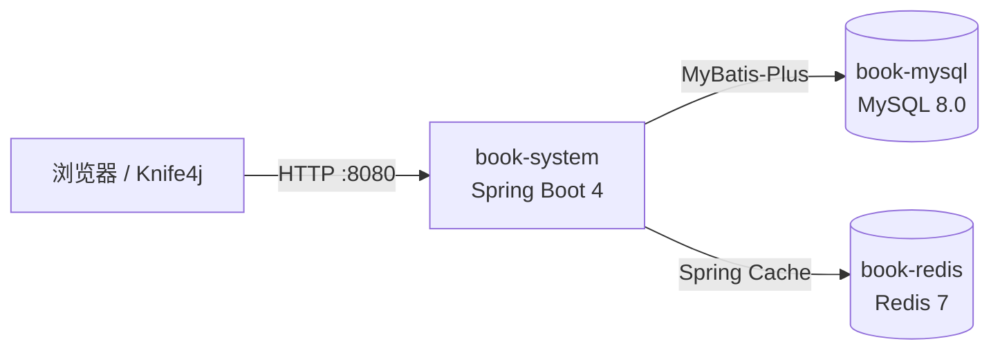

# book-system-boot

一个自己动手写的图书管理系统后端。用户可以注册登录，登录后管理自己的书单，
支持按阅读状态和关键词筛选。接口文档在线可调试，线上用 Docker 三个容器跑在腾讯云。

[](https://openjdk.org/)
[](https://spring.io/projects/spring-boot)
[](https://www.mysql.com/)
[](https://redis.io/)
[](https://www.docker.com/)

**在线调试：http://81.71.101.43:8080/doc.html**
（Knife4j 页面，可以直接发请求。先调 `/user/regist` 注册一个账号，
登录拿 token 再调图书接口。）

## 功能

| 模块 | 能做什么 | 实现要点 |
| --- | --- | --- |
| 用户 | 注册、登录、查当前登录人 | JWT 签发与校验，密码 MD5 存储，拦截器统一鉴权 |
| 图书 | 增删改查，按用户 / 状态 / 关键词筛选 | MyBatis-Plus，统一返回体，`@Validated` 参数校验 |
| 缓存 | 列表查询走缓存，增删改后自动清缓存 | Spring Cache + Redis |
| 文档 | 在线接口文档，填 token 后可直接调试 | Knife4j（OpenAPI 3） |
| 部署 | 应用 + MySQL + Redis 三容器一个内网，只暴露 8080 | Dockerfile + docker network |

## 技术栈

| 分类 | 技术 | 版本 | 用途 |
| --- | --- | --- | --- |
| 语言 | Java | 17 | |
| 框架 | Spring Boot | 4.1.1 | Web、依赖注入、自动配置 |
| 持久层 | MyBatis-Plus | 3.5.17 | 单表 CRUD、条件构造 |
| 数据库 | MySQL | 8.0 | 图书与用户数据 |
| 缓存 | Redis | 7 | 图书列表缓存 |
| 鉴权 | jjwt | 0.12.6 | 生成与校验 JWT |
| 接口文档 | Knife4j | 5.7.7 | OpenAPI 3 文档界面 |
| 构建 | Maven Wrapper | 仓库自带 | 依赖管理、打包 |
| 部署 | Docker | - | 三容器，手工 `docker run` |

## 架构



## 快速开始

### 1. 准备

- JDK 17
- MySQL 8（本地 3306）
- Redis 7（本地 6379）
- Maven 用仓库里的 `mvnw`，不用另装

### 2. 建库建表

```powershell
Get-Content docs\sql\schema.sql | mysql -uroot -p
```

（这个脚本开头是 `DROP TABLE`，会重建 `book` 和 `sys_user`，库里已有的数据会没。）

### 3. 配数据库密码

密码不进代码，从环境变量读（`application.yaml` 里写的是 `${DB_PASSWORD:}`）。

PowerShell：

```powershell
$env:DB_USERNAME="root"
$env:DB_PASSWORD="你的数据库密码"
```

IDEA：Run → Edit Configurations → Environment variables 填
`DB_USERNAME=root;DB_PASSWORD=你的数据库密码`

### 4. 启动

```powershell
.\mvnw spring-boot:run
```

### 5. 打开文档

http://localhost:8080/doc.html

演示账号 `demo` / `demo123`，或者自己调 `/user/regist` 注册一个。
登录返回的 token 填到文档页右上角的「Authorize」（Knife4j 里叫「OpenAPI 鉴权」），
之后 `/books` 下的接口才调得动。

## 接口一览

| 方法 | 路径 | 说明 | 需要 token |
| --- | --- | --- | --- |
| POST | `/user/regist` | 注册 | 否 |
| POST | `/user/login` | 登录，返回 token | 否 |
| GET | `/user/info` | 当前登录人信息 | 是 |
| GET | `/books` | 图书列表，可选 `uid` / `status` / `keyword` | 是 |
| GET | `/books/{bid}` | 图书详情 | 是 |
| POST | `/books` | 新增图书 | 是 |
| PUT | `/books/{bid}` | 修改图书 | 是 |
| DELETE | `/books/{bid}` | 删除图书 | 是 |
| GET | `/hello` | 连通性自检，返回固定 JSON | 否 |

白名单在 `config/WebMvcConfig.java` 里，除了上表标"否"的三个，还有文档页面本身
（`/doc.html`、`/webjars/**`、`/v3/api-docs/**`）也放行了。

## 项目结构

```text
book-system-boot
├── api/                      # .http 请求样例（IDEA HTTP Client）
├── docs/                     # 学习笔记 + 建表脚本
│   ├── day10-mysql-index-report.md
│   ├── day11-docker-notes.md
│   ├── day12-deploy-notes.md
│   └── sql/schema.sql
├── src/main/java/com/first/book
│   ├── common/               # Result 统一返回体
│   ├── config/               # OpenAPI、Redis 缓存、拦截器注册
│   ├── controller/           # Book / SysUser / Hello
│   ├── dto/                  # 登录、注册入参
│   ├── entity/               # Book、SysUser
│   ├── exception/            # 业务异常 + 全局异常处理
│   ├── interceptor/          # 登录拦截器
│   ├── mapper/               # MyBatis-Plus Mapper
│   ├── properties/           # myapp 配置绑定
│   ├── service/              # 接口与实现
│   └── util/                 # JWT、MD5、当前用户上下文
├── src/main/resources
│   └── application.yaml      # 密码从环境变量读
├── Dockerfile                # eclipse-temurin:17-jre
└── pom.xml
```

## 几个关键设计

**1. 统一返回体**
所有接口都返回 `Result<T>`：`code` 为 `1` 表示成功，`0` 表示失败，`message` 带原因，`data` 装数据。
前端只需要判 `code`，不用为每个接口写一套解析。

**2. 全局异常收敛**
`@RestControllerAdvice` 把业务异常、参数校验失败、未登录统一转成同一个 JSON。
好处是接口不会把 500 堆栈吐给调用方，后台日志里仍然有完整堆栈。

**3. JWT + 拦截器**
登录成功签发 token，`LoginInterceptor` 拦 `/**`，白名单放行登录、注册和文档页面。
用户信息放在 `UserContext` 里，业务层不用再从请求里扒 token。

**4. 列表查询缓存**
`@Cacheable` 加在列表查询上，`@CacheEvict` 加在增删改上——改完自动清缓存，避免读到旧列表。
缓存时踩过一个坑：实体没实现序列化，第二次查询直接报错，后来给缓存配了 JSON 序列化。

## 学习笔记

这个项目是一天一天写出来的，过程中踩的坑都留了记录：

- [Day 10 · MySQL 索引实测](docs/day10-mysql-index-report.md)：给 `book` 表加了索引，用 `EXPLAIN` 对比前后执行计划
- [Day 11 · Docker 打包](docs/day11-docker-notes.md)：第一次 `docker build`，以及镜像加速器全挂的那两千秒
- [Day 12 · 部署上线](docs/day12-deploy-notes.md)：腾讯云三容器部署、防火墙、SSH 加固

## 部署

镜像基于 `eclipse-temurin:17-jre`，构建和运行：

```bash
docker build -t book-system:1.0 .
docker run -d --name book-system --network book-net -p 8080:8080 \
  -e SPRING_DATASOURCE_URL="jdbc:mysql://book-mysql:3306/book_system?..." \
  -e SPRING_DATASOURCE_PASSWORD="$DB_PASSWORD" \
  -e SPRING_DATA_REDIS_HOST=book-redis \
  book-system:1.0
```

MySQL 和 Redis 跑在同一个自定义网络里，**不对公网暴露端口**。

完整过程（含防火墙、SSH 加固、踩坑）见 [Day 12 部署记录](docs/day12-deploy-notes.md)。

## TODO

- [ ] 补单元测试（MockMvc 覆盖 controller）
- [ ] 列表接口加分页
- [ ] 加一个简单的前端页面
- [ ] 用 GitHub Actions 做自动构建